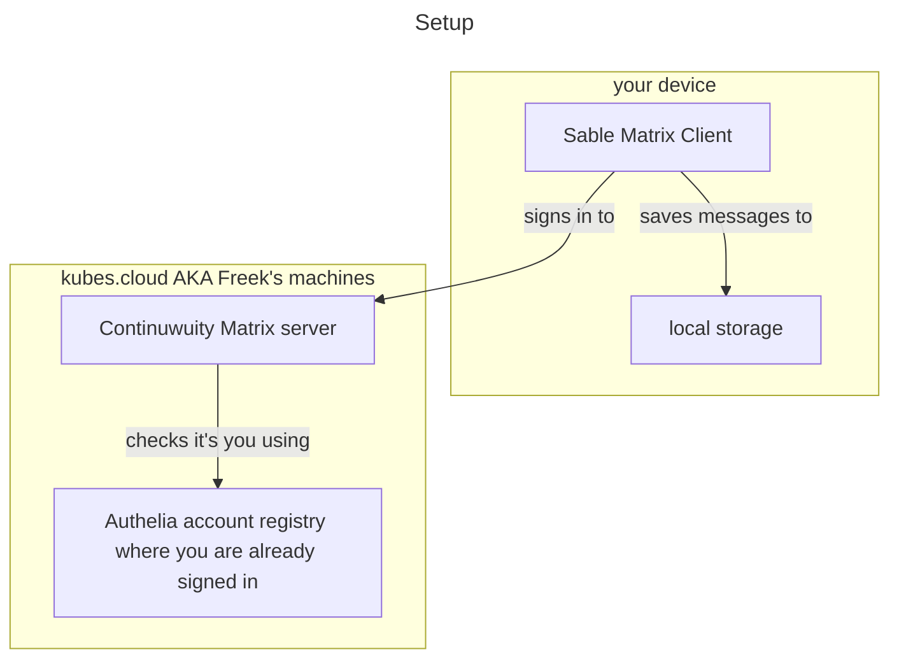

# First-time setup of your kubes.cloud account and sign in to Matrix

You just received an account on Freek's cluster.
In order to sign in to Matrix with this account, you'll need to do 2 things:

- First, sign in to the centralized account management (Authelia) to secure your kubes.cloud account: set up 2FA and change your password.
- Then, sign in to Matrix using the kubes.cloud account that you are already signed in to.

## Secure your account in Authelia

If at any point during the signup, you get the following picture, just refresh and it should go away:

- Go to [https://auth.kubes.cloud](https://auth.kubes.cloud)
- Sign in with the provided username / password and tick "remember me" if this is your own device

### Add 2FA app

- Now add your authenticator app (Aegis, Bitwarden premium, Proton or Google Authenticator all work) by clicking "Add OTP"

- Authelia will then send an e-mail to you to confirm it's you, enter the code from the mail you receive from authelia@freekhoekstra.nl , check your spam folder

- afterward, follow the prompts to add your authenticator app

### Change password

- after that is done, go to [https://auth.kubes.cloud/settings/security](https://auth.kubes.cloud/settings/security) and change your password

## Sign in to Matrix (sable)

In the following steps, you'll need to provide permission twice: first, allow the Continuwuity Matrix server to connect the Matrix account to your account in Authelia, then to Sable so you can sign in to the Matrix account with it.

- Go to [https://sable.kubes.cloud](https://sable.kubes.cloud)
- Click "Sign in with kubes.cloud"

- Here comes the first "allow": this allows the Continuwuity Matrix server to connect your account at auth.kubes.cloud to your Matrix account

->

- You can then choose your Matrix account username. This will be your _global_ handle across all of Matrix, visible to people from other servers too if you use public rooms.

- the second "authorize" step allows the client (Sable) on your device to interact with the Continuwuity Matrix server while signed in to your Matrix account

- Follow the instructions in Sable's onboarding

- After you are signed in to Sable, choose "start DM" and send a message to me: `@freek:kubes.cloud` and I will add you to the space with all the channels.

